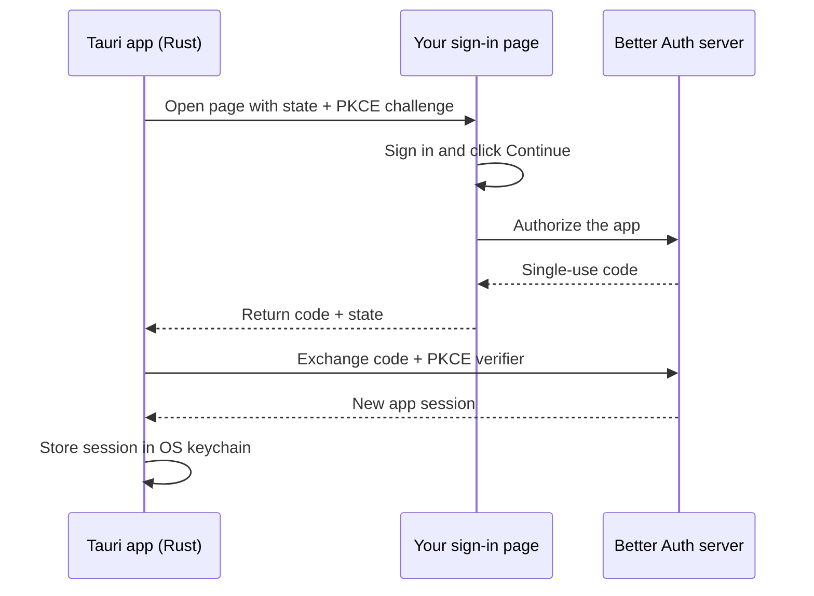

# tauri-plugin-better-auth

### Browser sign-in. Rust-held sessions. A token-free webview.

Bring [Better Auth](https://better-auth.com) to your [Tauri 3](https://tauri.app)
desktop app. Users sign in on your website through the system browser; the Rust
plugin stores their session in the OS keychain and authenticates API requests.

> [!NOTE]
> **This is the Tauri 3 line (`0.2.x` pre-releases, npm tag `next`).** Using
> Tauri 2? Use **`0.1.x`** from the [`main` branch](https://github.com/laakal/tauri-plugin-better-auth):
> `npm i tauri-plugin-better-auth@latest` and `tauri-plugin-better-auth = "0.1"` in
> `Cargo.toml`.
>
> | Your app        | npm                                         | crate           |
> | --------------- | ------------------------------------------- | --------------- |
> | Tauri 2         | `tauri-plugin-better-auth@latest` (`0.1.x`) | `0.1`           |
> | Tauri 3 (alpha) | `tauri-plugin-better-auth@next` (`0.2.x`)   | `0.2.0-alpha.1` |

[Get started](#setup) · [Run the example](examples/basic/README.md) ·
[Configuration](#configuration-reference) · [Security](SECURITY.md)

| Your users get                                                                     | Your app gets                                                                 |
| ---------------------------------------------------------------------------------- | ----------------------------------------------------------------------------- |
| Your existing sign-in page: passwords, email codes, social login, passkeys and 2FA | A session managed in Rust, with no token exposed to webview code              |
| A return to the app by deep link, local redirect or pasted code                    | A request bridge that adds the bearer token in Rust                           |
| Support for macOS, Windows and Linux                                               | Separate website and API domains, such as `example.com` and `api.example.com` |

> **Desktop support:** macOS, Windows and Linux. Mobile is not supported yet.
> See [Limitations](#limitations).

## On this page

- [How it works](#how-it-works)
- [Limitations](#limitations)
- [Requirements](#requirements)
- [Setup](#setup): server → hand-off page → Tauri app
- [Using it in the webview](#using-it-in-the-webview)
- [The auth bridge](#the-auth-bridge)
- [Transports](#transports)
- [Configuration reference](#configuration-reference)
- [Error codes](#error-codes)
- [Platform notes](#platform-notes)
- [Troubleshooting](#troubleshooting)
- [Security](#security)
- [Compared to other approaches](#compared-to-other-approaches)
- [Roadmap](#roadmap)

## How it works



1. **Sign in in the browser.** The app opens your hand-off page, where users
   sign in and explicitly choose to continue to the app.
2. **Return to the app.** A deep link, loopback redirect or pasted code carries
   a single-use authorization code back to Rust.
3. **Keep the session in Rust.** The plugin exchanges the code using PKCE,
   stores the session and emits `authenticated`. Webview requests use
   `tauriFetch`, which adds the bearer token in Rust.

- The browser session and the app session are separate: the app gets its own
  session, created in its own request. Server hooks see the app's headers, such
  as a device id.
- The code is single-use and expires in 5 minutes. It is useless without the
  PKCE verifier, which never leaves the app process.

Exact formats are in [PROTOCOL.md](PROTOCOL.md).

## Limitations

Some of these are gaps ([Roadmap](#roadmap)); most are the security model,
on purpose.

| Area                  | Status                                                                                                                                                                                                                                                                        |
| --------------------- | ----------------------------------------------------------------------------------------------------------------------------------------------------------------------------------------------------------------------------------------------------------------------------- |
| Platforms             | Desktop only: macOS, Windows, Linux. iOS and Android are not supported yet, on either line.                                                                                                                                                                                   |
| Streaming             | Not yet. `tauriFetch` buffers each request and response (4 MiB per request, 16 MiB per API response), and `timeout` (15 s) covers the whole response, body included. SSE and streamed AI answers arrive in one piece at the end, and fail if they take longer than `timeout`. |
| Sign-in methods       | All of them in the browser (`requestAuth()`). In the webview: email + password and email OTP. OAuth redirects, passkeys and 2FA run in the browser only.                                                                                                                      |
| Better Auth endpoints | The webview reaches [eight routes](#the-auth-bridge). Others (a plugin's endpoints, `/change-password`…) need `auth_route(...)`; `/tauri/*` never. By design.                                                                                                                 |
| API origins           | The bearer token goes only to the origins and path prefixes in `api_routes` (call it once per domain). Any other URL returns `403 FORBIDDEN_URL`. By design.                                                                                                                  |
| Redirects             | Never followed, so a `307` cannot carry the token elsewhere. Auth responses must be uncompressed JSON. By design.                                                                                                                                                             |

## Requirements

- **Better Auth** `>= 1.7.4`, with the `bearer()` plugin enabled on the server.
- **Tauri** `3.0.0-alpha.5` or newer, with `tauri-plugin-deep-link` for deep
  links. On Windows and Linux you also need `tauri-plugin-single-instance` with
  its `deep-link` feature. For **Tauri 2**, use the `0.1.x` releases.
- **Rust** 1.95+ (Tauri 3's minimum) and **Node.js** 22+ (or Bun).

## Tauri 3 and CEF

This release line (`0.2.x`) targets **Tauri 3** (alpha). For Tauri 2, use `0.1.x`.

Tauri 3 makes the webview runtime an explicit choice, and the plugin works with both:

```rust
tauri::Builder::default()
    .runtime(tauri_runtime_wry::Wry::default()) // system webview
    // or: .runtime(tauri_runtime_cef::Cef::default()) // Chromium (CEF)
```

With the **CEF** runtime:

- The frontend origin is `http://tauri.localhost` on every OS, and IPC is
  `http://ipc.localhost`. Your CSP needs `ipc: http://ipc.localhost` in
  `connect-src`, as with wry on Windows. The webview never calls your API
  directly anyway: `tauriFetch` goes through Rust.
- Deep links to a running app arrive through Chromium's process singleton; the
  runtime re-emits them, and `tauri-plugin-deep-link` delivers them as usual.
  Keep `tauri-plugin-single-instance` registered: a duplicate delivery is
  ignored, because a callback can only be claimed once.
- On macOS, `tauri dev` runs a dev `.app` bundle under `target/`, which macOS
  never registers for your scheme. `Transport::Auto` recognises it and uses the
  loopback redirect, as it does for wry's bare dev binary.

## Setup

You will configure three parts: your Better Auth server, a browser page that
returns users to the app, and the Tauri app itself. The npm package and Rust
crate are released together; use matching versions.

| Component             | Package / import                  |
| --------------------- | --------------------------------- |
| Better Auth server    | `tauri-plugin-better-auth`        |
| Browser hand-off page | `tauri-plugin-better-auth/proxy`  |
| Tauri webview         | `tauri-plugin-better-auth/client` |
| Tauri Rust backend    | crate `tauri-plugin-better-auth`  |

Install the npm package wherever you use the server, proxy or webview client:

```sh
npm install tauri-plugin-better-auth
```

> **Keep these values aligned:** use `com.example.app` as the client ID in all
> three parts below. The scheme must also match the deep-link registration.
> Replace the example domains with your own.

### 1. Server

```ts
// auth.ts
import { betterAuth } from 'better-auth';
import { bearer } from 'better-auth/plugins';
import { tauri } from 'tauri-plugin-better-auth';

export const auth = betterAuth({
  // …your database, sign-in methods, trustedOrigins…
  plugins: [
    bearer(), // the app authenticates with `Authorization: Bearer`
    tauri({
      clientID: 'com.example.app', // shared with the app and the hand-off page
      authorizeOrigins: ['https://example.com'], // the origin of your hand-off page
    }),
  ],
});
```

The plugin adds two endpoints and needs no database migration, because codes use
Better Auth's `verification` table:

- `POST /tauri/authorize` mints a single-use code for the signed-in user.
- `POST /tauri/token` exchanges that code for a new session.

<details>
<summary>Optional: reject or tag app sessions with server hooks</summary>

**Rejecting or tagging app sessions.** The session is created inside the
`/tauri/token` request, so your session hooks see the app's headers:

```ts
databaseHooks: {
  session: {
    create: {
      before: async (session, ctx) => {
        if (ctx?.path !== '/tauri/token') return;
        const deviceId = ctx.headers?.get('x-device-id');
        if (!deviceId) {
          throw new APIError('FORBIDDEN', { code: 'DEVICE_REQUIRED', message: 'Device id required' });
        }
        return { data: { ...session, deviceId } };
      },
    },
  },
},
```

- **Throwing an `APIError`:** the app receives your code, and no session is
  created.
- **Returning `false`:** the app receives `SESSION_REJECTED`.

</details>

### 2. Hand-off page

A page on your website, for example `https://example.com/desktop`, that the app
opens in the browser. It needs the proxy client and one rule: **ask for consent
after every login**.

```ts
import { createAuthClient } from 'better-auth/client';
import { tauriProxyClient } from 'tauri-plugin-better-auth/proxy';

const authClient = createAuthClient({
  baseURL: 'https://api.example.com',
  plugins: [
    tauriProxyClient({
      scheme: 'com.example.app',
      clientID: 'com.example.app',
    }),
  ],
});

const request = authClient.tauri.getRequest(); // { status: 'ok' | 'none' | 'invalid', … }

// 1. Not signed in? Show your normal sign-in UI on this page.
//    Social sign-in: use ABSOLUTE callback URLs back to this page:
//    callbackURL, newUserCallbackURL and errorCallbackURL = 'https://example.com/desktop'
// 2. Signed in: show "Continue to <App> as <email>" and wait for a click.
async function onContinueClick() {
  const { data, error } = await authClient.tauri.handoff();
  if (error) return showError(error.message);
  authClient.tauri.openApp(data.redirectTo); // opens the app
  showCode(data.code); // optional fallback: "the app did not open? paste this code"
}

// Cancel: tell the app the user declined.
const cancelUrl = authClient.tauri.cancelLink();
if (cancelUrl) authClient.tauri.openApp(cancelUrl);
```

**Page behaviour:**

- `getRequest()` reads the app's parameters from the URL, keeps them in
  `sessionStorage` (so they survive an OAuth round trip in the same tab) and
  removes them from the address bar.
- A loopback `redirect_uri` is accepted only as exactly
  `http://127.0.0.1:<port>/auth/callback` or `http://[::1]:<port>/auth/callback`.

**Rules for the page:**

- Always require a click on "Continue". Any local app can register your scheme
  and start a flow, and the user's consent is what binds the sign-in to _their_
  app.
- If you show the code, warn: _never share this code; paste it only into the app
  on this computer._
- If the page runs on another subdomain than Better Auth, the cookies must reach
  the API. The usual Better Auth setup with `credentials: 'include'` and CORS
  covers that.

### 3. Tauri app

**Rust** (`src-tauri/Cargo.toml`):

```toml
[dependencies]
tauri-plugin-better-auth = "0.2.0-alpha.1"
tauri-plugin-deep-link = "3.0.0-alpha.3"
tauri-runtime-wry = "3.0.0-alpha.5" # or tauri-runtime-cef, see "Tauri 3 and CEF"

[target.'cfg(any(target_os = "macos", windows, target_os = "linux"))'.dependencies]
tauri-plugin-single-instance = { version = "3.0.0-alpha.3", features = [
  "deep-link",
] }
```

```rust
// src-tauri/src/lib.rs
pub fn run() {
    let mut builder = tauri::Builder::default().runtime(tauri_runtime_wry::Wry::default());
    #[cfg(desktop)]
    {
        // First: forwards deep links to the running app on Windows/Linux.
        builder = builder.plugin(tauri_plugin_single_instance::init(|_app, _argv, _cwd| {}));
    }
    builder
        .plugin(tauri_plugin_deep_link::init())
        .plugin(
            tauri_plugin_better_auth::Builder::new()
                .base_url("https://api.example.com/api/auth")
                .sign_in_url("https://example.com/desktop")
                .scheme("com.example.app")
                .client_id("com.example.app")
                // Your API, reachable from the webview with the bearer token:
                .api_routes("https://api.example.com", ["/api/"])
                .build(),
        )
        .run(tauri::generate_context!())
        .expect("error while running tauri application");
}
```

**`tauri.conf.json`:** register the scheme.

```json
{
  "plugins": {
    "deep-link": { "desktop": { "schemes": ["com.example.app"] } }
  }
}
```

**Capabilities:** grant the plugin to your window.

```json
{ "permissions": ["core:default", "better-auth:default"] }
```

`better-auth:default` allows `request_auth`, `authenticate`, `cancel_auth`,
`get_session`, `sign_out`, `fetch` and `fetch_cancel`. You can list the
individual `better-auth:allow-*` permissions instead. No command returns the
token.

**CSP.** The webview only talks to IPC, so `connect-src` does not need your API
origin:

```
connect-src 'self' ipc: http://ipc.localhost
```

## Using it in the webview

```ts
import { emailOTPClient } from 'better-auth/client/plugins';
import { createAuthClient } from 'better-auth/react'; // or /client, /vue, /svelte…
import {
  asTauriClient,
  onAuthError,
  requestAuth,
  tauriFetch,
  withTauri,
} from 'tauri-plugin-better-auth/client';

export const authClient = asTauriClient(
  createAuthClient(
    withTauri({
      baseURL: 'https://api.example.com/api/auth',
      plugins: [emailOTPClient()],
    }),
  ),
);

// Browser sign-in (any method). Completes with an `authenticated` event.
await requestAuth(); // or requestAuth({ provider: 'github' })

// In-app sign-in with an email code: the session lands in Rust.
await authClient.signIn.emailOtp({ email, otp });

// The session, without its token. useSession() refreshes after browser sign-ins.
const { data } = authClient.useSession();

// Your API, with the bearer token added in Rust:
const res = await tauriFetch('https://api.example.com/api/projects');
```

**What `withTauri` does:**

- It routes Better Auth through `tauriFetch`.
- It disables Better Auth's redirect plugin, so no response can navigate the
  webview away.
- It refreshes `useSession()` on sign-in and sign-out events.

**What `asTauriClient` does:** it narrows the types. Sessions have no `token`, and
actions the bridge refuses (`signIn.social`, `listSessions`, `oneTimeToken`…)
disappear.

**Plain functions:**

- `requestAuth`, `authenticate(codeOrLink)`, `cancelAuth`
- `getSession({ cachedOnly })`
- `signOut`
- events: `onAuthenticated`, `onSignedOut({ reason })`, `onAuthError`

`getSession({ cachedOnly: true })` answers from memory, which suits startup route
guards. Without it, the session is checked with the server. When the server is
unreachable you get the cached session with `offline: true`, and the user is not
signed out.

**Other API clients.** Give them `tauriFetch`:

```ts
const link = new OpenAPILink(contract, { url, fetch: tauriFetch }); // oRPC
const api = ky.create({ fetch: tauriFetch });
```

`tauriFetch` buffers bodies: text and binary work, streaming does not (yet;
see [Limitations](#limitations)).

## The auth bridge

The bridge is a **contract, not a filter**. Webview code can reach exactly these
Better Auth routes:

| Route                                                                                    | What happens                                                         | The webview receives                             |
| ---------------------------------------------------------------------------------------- | -------------------------------------------------------------------- | ------------------------------------------------ |
| `GET /get-session`                                                                       | Answered by the Rust session controller (cache, revocation, offline) | `{ session, user }` without the token, or `null` |
| `POST /sign-out`                                                                         | Signs out in Rust: local state always cleared, server best effort    | `{ success: true }`                              |
| `POST /email-otp/send-verification-otp`                                                  | Forwarded                                                            | the JSON body, scrubbed                          |
| `POST /sign-in/email-otp`, `/sign-in/email`, `/sign-up/email`, `/email-otp/verify-email` | Forwarded. A returned session is verified and stored in Rust.        | `{ redirect: false, user }`                      |
| `POST /update-user`                                                                      | Forwarded with the bearer token                                      | the JSON body, scrubbed                          |
| anything else under the auth path                                                        | Refused, nothing sent                                                | `403 UNSUPPORTED_AUTH_OPERATION`                 |

**App routes** (from `api_routes`) are forwarded with the bearer token and your
app headers. Everything else returns `403 FORBIDDEN_URL`.

**On every request, the bridge:**

- Drops `authorization`, `cookie`, `origin`, `referer`, `user-agent`, `sec-*`,
  hop-by-hop headers, and any header your `headers()` callback sets. The page
  cannot spoof them.
- Never follows redirects.
- Strips `set-cookie` and `set-auth-token` from responses.
- Requires auth responses to be uncompressed JSON. Anything else returns
  `502 BRIDGE_UNPARSEABLE`.
- Caps bodies: 4 MiB per request, 16 MiB per API response.

**Scrubbing.** "Scrubbed" means the keys `token`, `accessToken`, `refreshToken`,
`idToken` (and snake_case forms) are removed at any depth. Top-level `url` and
`redirect` are removed too.

**Extending the allowlist.** Use `auth_route`:

```rust
.auth_route("POST", "/change-password", tauri_plugin_better_auth::AuthRouteKind::SignIn)
.auth_route("POST", "/organization/create", tauri_plugin_better_auth::AuthRouteKind::Passthrough)
```

- `SignIn`: a returned session is captured into Rust.
- `Passthrough`: the response is scrubbed.
- `/tauri/*` can never be added.

**Not supported in the webview:**

- OAuth redirects
- passkeys and 2FA (their continuation cookies cannot cross a cookie-less bridge)

Use `requestAuth()` for those: the browser handles every method.

## Transports

How the browser returns to the app (`Builder::transport`, or per call with
`requestAuth({ transport })`):

| Transport        | How                                                                                                 | When                                                      |
| ---------------- | --------------------------------------------------------------------------------------------------- | --------------------------------------------------------- |
| `deep-link`      | `<scheme>://auth/callback?code&state`                                                               | Installed apps                                            |
| `loopback`       | A one-shot listener on `http://127.0.0.1:<random port>`                                             | `tauri dev`, or platforms where scheme registration fails |
| `auto` (default) | Deep link for an installed macOS `.app` and for release builds on Windows/Linux; loopback otherwise | Most apps                                                 |

Paste always works too. `authenticate(input)` accepts the 32-character code or
the whole callback link.

**Loopback details:**

- It answers only `GET /auth/callback` with the right `Host` and `state`.
- It keeps waiting through wrong or stray requests.
- It closes after the first valid callback, or when the pending sign-in expires
  (10 minutes by default).

## Configuration reference

<details>
<summary>Server, hand-off page and Rust options</summary>

### Server: `tauri(options)`

| Option             | Default                   | Description                                                                            |
| ------------------ | ------------------------- | -------------------------------------------------------------------------------------- |
| `clientID`         | `"tauri"`                 | Must match the app and the hand-off page                                               |
| `codeExpiresIn`    | `300`                     | Seconds, 30–3600                                                                       |
| `authorizeOrigins` | none                      | Origins allowed to call `/tauri/authorize`. Strongly recommended.                      |
| `rateLimit`        | `{ window: 60, max: 10 }` | Per IP for both endpoints, or `false`. Enforced when Better Auth's rate limiter is on. |

### Hand-off page: `tauriProxyClient(options)`

| Option         | Default            | Description                                                               |
| -------------- | ------------------ | ------------------------------------------------------------------------- |
| `scheme`       | required           | The app's scheme                                                          |
| `clientID`     | `"tauri"`          |                                                                           |
| `callbackPath` | `"/auth/callback"` |                                                                           |
| `providers`    | `[]`               | Social providers the page may auto-start from `requestAuth({ provider })` |
| `requestTTL`   | `600`              | Seconds a captured request survives in `sessionStorage`                   |

**Actions:**

- `authClient.tauri.getRequest()`, `handoff()`, `cancelLink()`, `openApp(url)`,
  `clear()`
- `authClient.tauri.authorize()`, the raw endpoint call

### Rust: `tauri_plugin_better_auth::Builder`

| Method                           | Default                  | Description                                                  |
| -------------------------------- | ------------------------ | ------------------------------------------------------------ |
| `base_url(url)`                  | required                 | Better Auth base URL. https, or http on localhost only.      |
| `sign_in_url(url)`               | required                 | The hand-off page                                            |
| `scheme(s)`                      | required                 | Also list it in `plugins.deep-link.desktop.schemes`          |
| `client_id(id)`                  | `"tauri"`                |                                                              |
| `callback_path(p)`               | `"/auth/callback"`       |                                                              |
| `api_routes(origin, prefixes)`   | none                     | App API reachable through `tauriFetch`                       |
| `auth_route(method, path, kind)` | none                     | Extends the bridge allowlist                                 |
| `transport(t)`                   | `Auto`                   |                                                              |
| `pending_ttl(d)`                 | 10 min                   | 1–60 min                                                     |
| `timeout(d)`                     | 15 s                     | Per request                                                  |
| `main_window(label)`             | `"main"`                 | Focused when a sign-in returns                               |
| `store(impl SessionStore)`       | OS keychain              | `KeyringStore`, `MemoryStore`, or your own (e.g. Stronghold) |
| `headers(fn)`                    | none                     | Headers sent with every auth/API request (e.g. device id)    |
| `on_session(fn)`                 | none                     | Rust callback on sign-in and sign-out                        |
| `opener(fn)`                     | system browser           | How the sign-in page is opened                               |
| `profile_dir(path)`              | `<app data>/better-auth` | Where the non-secret profile cache lives                     |

**From Rust:** `app.better_auth()` gives `request_auth`, `authenticate`,
`cancel_auth`, `session`, `sign_out`, `handle_url` and `bearer_token`. The last
is for your own Rust HTTP calls; never send it to the webview.

**Features:** `keyring` is on by default and provides the OS credential store.
Disable it and pass your own `store()` to avoid the dependency.

</details>

## Error codes

<details>
<summary>Rust and server error codes</summary>

Errors are `{ code, message }`. `TauriAuthError` in JS carries the `code`. Match on
the code, never on the message.

**From the Rust plugin:**

| Code                                               | Meaning                                                               |
| -------------------------------------------------- | --------------------------------------------------------------------- |
| `NO_PENDING_FLOW`                                  | A callback or paste arrived with no sign-in in progress               |
| `FLOW_EXPIRED`                                     | The sign-in waited longer than `pending_ttl`                          |
| `INVALID_CODE` / `INVALID_CALLBACK`                | The pasted value or link is malformed or not for this app             |
| `ACCESS_DENIED`                                    | The user cancelled in the browser                                     |
| `SUPERSEDED`                                       | A newer sign-in, a cancel or a sign-out happened meanwhile            |
| `OPEN_BROWSER_FAILED`                              | The browser could not be opened (`requestAuth` still returns the URL) |
| `NETWORK`                                          | The server could not be reached                                       |
| `SESSION_REJECTED`                                 | The server rejected or immediately deleted the new session            |
| `STORE` / `STORE_UNAVAILABLE`                      | The keychain failed or is missing                                     |
| `UNSUPPORTED_AUTH_OPERATION` / `FORBIDDEN_URL`     | The bridge refused the request                                        |
| `BRIDGE_UNPARSEABLE` / `BRIDGE_RESPONSE_TOO_LARGE` | The bridge could not pass the response on safely                      |
| `INVALID_REQUEST` / `ABORTED` / `CONFIG`           | A malformed request, an aborted request, invalid configuration        |

**From the server** (also passed through to the app):

| Code                       |
| -------------------------- |
| `INVALID_CLIENT_ID`        |
| `ORIGIN_NOT_ALLOWED`       |
| `INVALID_STATE`            |
| `INVALID_CODE_CHALLENGE`   |
| `INVALID_CODE_VERIFIER`    |
| `INVALID_OR_EXPIRED_CODE`  |
| `STATE_MISMATCH`           |
| `PKCE_VERIFICATION_FAILED` |
| `USER_NOT_FOUND`           |
| `SESSION_REJECTED`         |

**Your hooks' own codes** (e.g. `DEVICE_LIMIT_REACHED`) arrive unchanged.

</details>

## Platform notes

**macOS**

- Deep links reach only an **installed `.app` bundle**. `tauri dev` cannot
  receive them, so `auto` uses loopback there. To test deep links, build the
  bundle (`tauri build --debug`) and open it once.
- The keychain ties access to the app's code signature. Unsigned development
  builds may ask for keychain access after each rebuild. Use
  `.store(MemoryStore::new())` while iterating if that gets in the way.

**Windows**

- Deep links start a new process unless `tauri-plugin-single-instance` (with
  `deep-link`) is registered **first**.
- Credential Manager limits a secret to 2560 bytes. The plugin stores only the
  token, session id and expiry there.

**Linux**

- The same single-instance rule as Windows applies.
- The keychain needs a running Secret Service (GNOME Keyring, KWallet…). Without
  one, the session lives in memory for the run and the app gets a
  `STORE_UNAVAILABLE` error event.
- AppImages need a desktop entry for the scheme. Loopback avoids that.

## Troubleshooting

- **The browser finished but the app never signed in.**
  - Check the scheme is in `plugins.deep-link.desktop.schemes`. The plugin warns
    at startup when it is not.
  - Check the app is installed (macOS) and single-instance is registered first
    (Windows/Linux).
  - Use loopback, or paste the code.
- **`NO_PENDING_FLOW` after a deep link.** The app was restarted mid-sign-in. The
  verifier is kept in memory only, on purpose. Start again.
- **`ORIGIN_NOT_ALLOWED`.** The hand-off page origin is missing from
  `authorizeOrigins`.
- **`401` on `/tauri/authorize` right after signing in.** The page's request
  carries no session cookie. Check `credentials: 'include'`, CORS, and
  `trustedOrigins` for the page origin.
- **The server warns that `bearer()` is not registered.** Add it. The app
  authenticates with bearer tokens.

## Security

- PKCE S256, single-use 5-minute codes, constant-time comparisons.
- The authorizing browser session is checked against the database, bypassing
  `cookieCache`.
- An origin allowlist on authorize.
- A user click for consent.
- Callbacks are matched to the pending state atomically.
- No redirects.
- Rust-only configuration.
- A token that never reaches the webview, logs or events.

See [SECURITY.md](SECURITY.md) for the threat model and how to report a
vulnerability.

## Compared to other approaches

**Better Auth's Electron integration** (`@better-auth/electron`) uses the same
code-plus-PKCE idea. This plugin differs in three ways:

- It hands the code over with an explicit `authorize` call, not a redirect cookie
  on the API origin. That cookie cannot be read by a page on another subdomain.
- It authenticates the app with bearer tokens, not replayed cookies, so the
  custom scheme never needs to be a trusted origin.
- It keeps the session in Rust behind a bridge, not in the renderer.

**`@daveyplate/better-auth-tauri`** is a JS-only package. Social sign-in returns
to the app through a deep link, and the session lives in the webview's JS
context.

**This plugin:**

- holds the session in Rust, outside the webview
- uses PKCE-bound single-use codes, so an intercepted deep link is useless
- supports any sign-in method through your own page
- gives the webview a token-free request bridge

## Example

[`examples/basic`](examples/basic) contains a Bun + Better Auth server with a
hand-off page and a Tauri app using every feature. Follow the [example setup instructions](examples/basic/README.md) to run it locally.

## Roadmap

No dates: items ship when they are ready, in the order below. Open an
[issue](https://github.com/laakal/tauri-plugin-better-auth/issues) to ask for
something or to help.

**Next: streaming responses** (a minor release on both lines)

- `tauriFetch` returns a `Response` whose body streams, for `api_routes`
  responses: SSE, AI SDK `streamText`, large downloads.
- Chunks travel from Rust over a Tauri channel. `abort()` stops the request in
  Rust.
- `timeout` then covers the wait for response headers; a separate idle timeout
  covers the gap between chunks, so a long answer streams for as long as it
  keeps sending.
- Unchanged: auth routes stay buffered and scrubbed, and the allowlists,
  header filtering and the no-redirect rule apply as today.

**Then: Tauri 3 stable**

- The Tauri 3 line (`0.2.x`, npm tag `next`) leaves pre-release once Tauri 3
  is stable.
- The Tauri 2 line (`0.1.x`) keeps getting security and compatibility fixes.

**Later: mobile** (iOS and Android)

- Wanted, not scheduled. It needs a mobile keychain store and the platform
  hand-off (app links and custom tabs).

**Not planned** (by design, see [Security](#security)):

- Exposing the session token to webview code.
- Following redirects, or sending the token to origins outside `api_routes`.
- Passkeys and 2FA inside the webview: they run on your sign-in page in the
  browser.

## Versioning

The npm package and the crate are released together under one version. The
wire protocol is versioned separately ([PROTOCOL.md](PROTOCOL.md)); within v1,
changes are additive only, so installed apps keep working when you upgrade the
server.

## License

[MIT](LICENSE)
